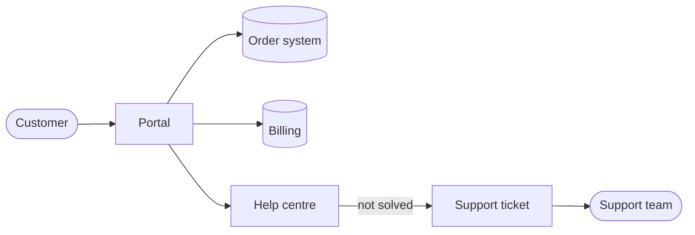
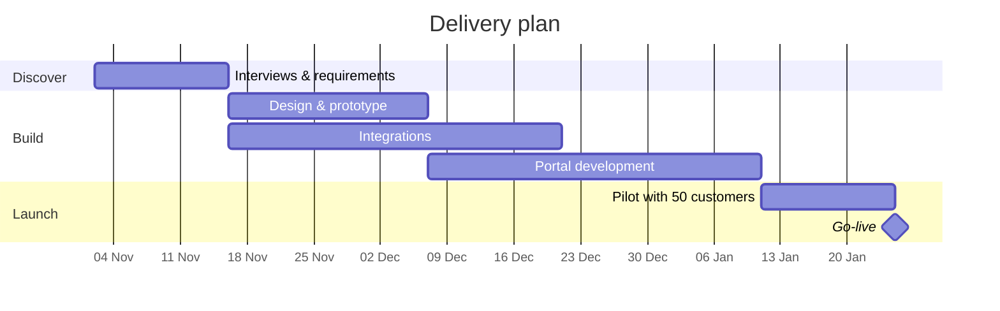

# Project Proposal

Customer self-service portal

**Prepared by** {{author}}  
**For** the Leadership Team  
**Date** {{date_long}}

<!-- pagebreak -->

## Summary

We propose building a **customer self-service portal** where customers can follow their orders, download invoices and solve common problems without calling us. The project takes **14 weeks**, costs **€186,000** and is expected to cut support calls by a third within six months of launch.

| | |
|:--|:--|
| **Sponsor** | Head of Customer Operations |
| **Project lead** | {{author}} |
| **Budget** | €186,000 |
| **Duration** | 14 weeks |
| **Decision needed by** | {{date_long}} + 2 weeks |

## The problem

Our support team answers about **2,400 calls a month**. Six out of ten are questions customers could answer themselves if they had access to their own information:

- *Where is my order?* (31 %)
- *Can you send me a copy of my invoice?* (18 %)
- *How do I change my delivery address?* (11 %)

Customers wait on average 7 minutes on the phone, and satisfaction with support has dropped for three quarters in a row.

## Objectives

| Objective | Measure | Target | By |
|:----------|:--------|-------:|:---|
| Fewer routine calls | Monthly calls about orders and invoices | −35 % | 6 months after launch |
| Faster answers | Median time to an answer | < 1 min | At launch |
| Happier customers | Support satisfaction score | ≥ 8.0 | 6 months after launch |
| Adoption | Active customers using the portal | 50 % | 12 months after launch |

## Proposed solution

A secure web portal, linked to the order and billing systems, with four parts:

1. **Order tracking** with live delivery status.
2. **Documents**: invoices, credit notes and delivery notes to download.
3. **Account settings**: addresses, contacts and notification preferences.
4. **Help centre** with searchable articles and a contact form that routes to the right team.

### Scope

**In scope**

- Web portal (desktop and mobile browsers)
- Single sign-on with existing accounts
- Integration with order and billing systems
- 40 help articles at launch

**Out of scope**

- Native mobile apps
- Online payments (phase 2)
- Live chat
- Changes to the billing system itself

## Timeline

## Team

| Role | Who | Time |
|:-----|:----|-----:|
| Project lead | {{author}} | 50 % |
| Product designer | To be assigned | 100 % |
| Developers | 2 from the web team | 100 % |
| Integration engineer | IT department | 60 % |
| Content writer | Customer Operations | 40 % |

## Budget

| Item | Cost (€) |
|:-----|---------:|
| Design and development (internal) | 98,000 |
| Integration work | 34,000 |
| Hosting and licences (first year) | 18,000 |
| Help-centre content | 12,000 |
| Testing and accessibility audit | 9,000 |
| Contingency (10 %) | 15,000 |
| **Total** | **186,000** |

The portal pays for itself in about 16 months through lower support costs.

## Risks

| Risk | Mitigation |
|:-----|:-----------|
| Integration with the billing system takes longer than planned | Start integration work in week 1; use a read-only copy first |
| Customers don't find the portal | Links in every invoice and e-mail; announce in the newsletter |
| Security of customer data | Single sign-on, penetration test before launch |

> [!TIP]
> A two-week pilot with 50 customers lets us fix problems before everyone sees the portal.

## Approval

| Name | Role | Decision | Date |
|:-----|:-----|:---------|:-----|
| | Head of Customer Operations | ☐ Approve ☐ Reject | |
| | Chief Financial Officer | ☐ Approve ☐ Reject | |
