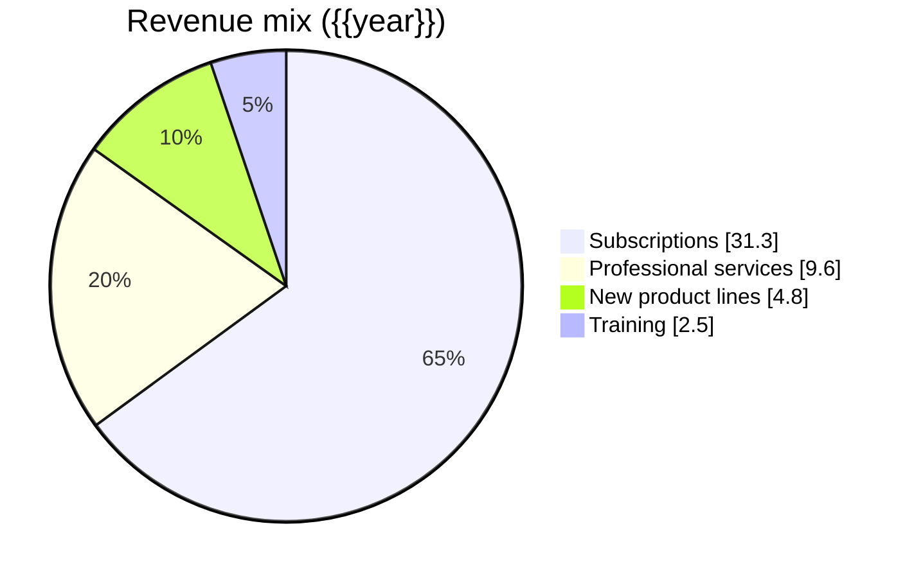
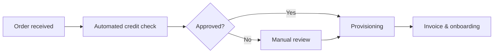

<div class="cover">

# Annual Performance Report {{year}}

Growth, efficiency and the year ahead

**{{author}}**  
Strategy & Finance · {{date_long}}

</div>

<!-- pagebreak -->

## Contents

[TOC]

<!-- pagebreak -->

## Executive summary

{{year}} was a year of disciplined growth. Revenue rose by **18 %** while operating costs grew by only 6 %, lifting the operating margin to its highest level in five years. Customer retention improved in every region, and the two product lines launched in the spring already contribute one fifth of new bookings.

<div class="kpis">

- **€48.2 M** revenue, +18 % on last year
- **21.4 %** operating margin, up 3.1 points
- **94 %** customer retention, up from 89 %
- **312** employees in 6 countries

</div>

> [!IMPORTANT]
> We recommend investing a further €3.5 M in the two new product lines in {{next_year}}, funded from operating cash flow. Section 6 sets out the plan.

## Financial results

### Revenue by quarter

Every quarter beat the same quarter of last year. The fourth quarter was the strongest on record, driven by renewals and the enterprise tier.

```chart
{
  type: "bar",
  data: {
    labels: ["Q1", "Q2", "Q3", "Q4"],
    datasets: [
      { label: "Last year (€ M)", data: [9.1, 9.8, 10.2, 11.7], backgroundColor: "#9fb3c8" },
      { label: "{{year}} (€ M)", data: [10.4, 11.5, 12.1, 14.2], backgroundColor: "#14324a" }
    ]
  },
  options: { plugins: { title: { display: true, text: "Quarterly revenue" } } }
}
```

### Results by region

| Region          | Revenue (€ M) | Growth | Margin | Headcount |
|:----------------|--------------:|-------:|-------:|----------:|
| Benelux         |          16.8 |  +14 % |   24 % |       118 |
| DACH            |          12.3 |  +22 % |   21 % |        74 |
| France          |           8.9 |  +17 % |   19 % |        52 |
| Nordics         |           6.1 |  +25 % |   20 % |        38 |
| United Kingdom  |           4.1 |   +9 % |   15 % |        30 |
| **Total**       |      **48.2** | **+18 %** | **21.4 %** | **312** |

### Where the revenue comes from



## Customers

Retention reached 94 %, and net revenue retention 112 %: existing customers spent more with us than the year before. The satisfaction survey (n = 1,240) gave an average of **8.6 / 10**.[^survey]

- Enterprise customers grew from 41 to 58.
- Average time to resolve a support request fell from 19 to 11 hours.
- 72 % of new customers came through referrals and partners.

## Operations

The shared-services programme finished on schedule. Finance, HR and IT now run on one platform, which saved €1.2 M in its first year.



## Risks

| Risk                                   | Likelihood | Impact | Response                                  |
|:---------------------------------------|:----------:|:------:|:------------------------------------------|
| Price pressure from new competitors    | <span class="badge amber">Medium</span> | <span class="badge red">High</span> | Bundle services; focus on retention |
| Hiring senior engineers                | <span class="badge red">High</span> | <span class="badge amber">Medium</span> | Remote roles; graduate programme |
| Currency exposure in the UK            | <span class="badge green">Low</span> | <span class="badge amber">Medium</span> | Natural hedge through local costs |

## Recommendations for {{next_year}}

1. **Invest €3.5 M** in the two new product lines to reach 30 % of new bookings.
2. **Open a delivery centre** in Lisbon to support growth in southern Europe.
3. **Keep cost growth below 8 %** while revenue grows by at least 15 %.
4. **Launch a customer advisory board** with the 20 largest accounts.

## Appendix: method

Figures are audited unless marked otherwise. Growth is measured against the restated figures of the previous year.[^restated] Regional results allocate central costs by revenue share.

[^survey]: Online survey sent to all active customers in November; response rate 38 %.
[^restated]: Last year's figures were restated for the sale of the hardware business.
