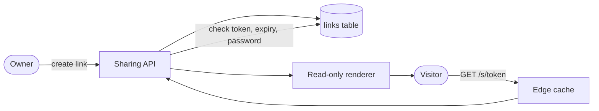
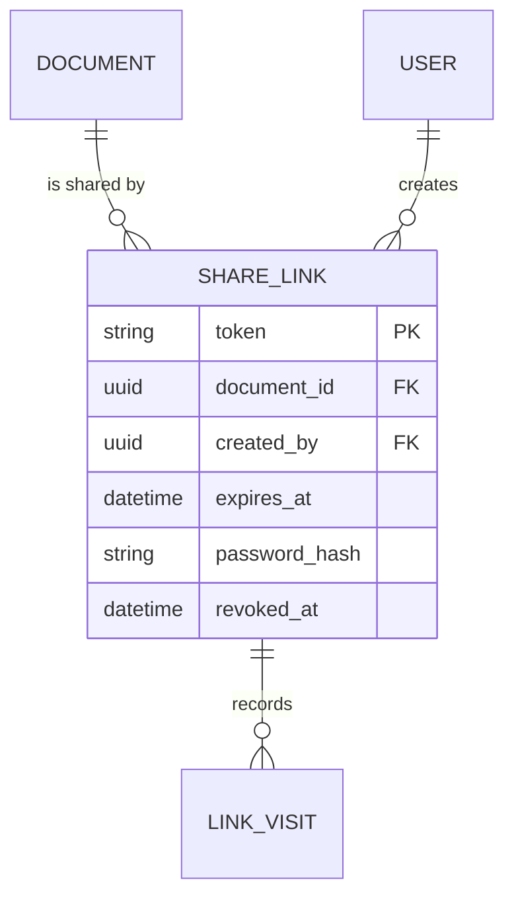
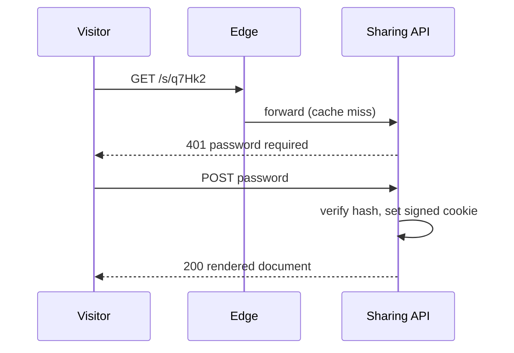

# Design doc: Document sharing links

| | |
|:--|:--|
| **Status** | <span class="badge amber">In review</span> |
| **Author** | {{author}} |
| **Reviewers** | Platform team, Security |
| **Last updated** | {{date_long}} |

## Summary

Let users share a read-only link to a document with people outside their organisation. Links can expire, can be protected with a password and can be revoked at any time.

## Goals and non-goals

<div class="cols">
<div>

**Goals**

- Share a read-only view with one click
- Optional expiry date and password
- Revoke a link instantly
- See how often a link was opened

</div>
<div>

**Non-goals**

- Editing through a link
- Sharing whole folders
- Embedding documents in other sites

</div>
</div>

## Background

Today, users export a PDF and send it by e-mail. The PDF goes out of date as soon as the document changes, and we can't take it back. Support receives about 40 requests a month for "a link I can send to a client".

## Proposed design



A link is a random 128-bit token. The sharing API checks the token on every request; the edge cache keeps rendered pages for 60 seconds, and revoking a link purges the cache.

### Data model



### API

| Method | Path | Description |
|:-------|:-----|:------------|
| `POST` | `/api/documents/{id}/links` | Create a link (expiry and password optional) |
| `GET` | `/api/documents/{id}/links` | List the links of a document |
| `DELETE` | `/api/links/{token}` | Revoke a link |
| `GET` | `/s/{token}` | Open the shared document (public) |

```json
{
  "token": "q7Hk2-Zp9Lw",
  "url": "https://app.example.com/s/q7Hk2-Zp9Lw",
  "expiresAt": "{{next_year}}-01-31T23:59:59Z",
  "passwordProtected": true,
  "visits": 0
}
```

### Opening a protected link



## Alternatives considered

1. **Signed URLs without a database row.** Simple, but links can't be revoked or counted.
2. **Guest accounts.** Strong control, but visitors would have to sign up — too much friction.

## Security and privacy

- Tokens are 128 bits from a secure random source and never logged.
- Passwords are hashed with Argon2id; five failed attempts lock the link for 15 minutes.
- Visit records keep a country and a timestamp only; no IP addresses.

> [!WARNING]
> Shared pages must send `X-Robots-Tag: noindex` so search engines never index them.

## Rollout

| Week | Step |
|-----:|:-----|
| 1–2 | API and data model behind a feature flag |
| 3 | Read-only renderer and edge caching |
| 4 | Internal beta |
| 5 | 10 % of customers, then everyone |

## Open questions

- [ ] Should admins be able to turn sharing off for the whole organisation?
- [ ] Do we show visitors who owns the document?
- [x] Maximum expiry: 1 year (agreed with Security)
