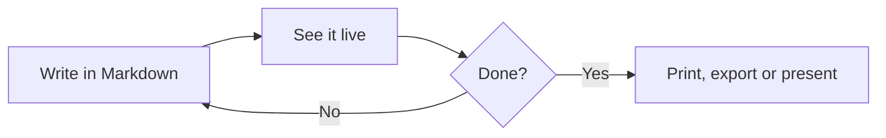

# Welcome to mdcraft

mdcraft is a word processor for **Markdown**: you write plain text on the left, and a finished document — or a slide deck — appears on the right as you type. This page shows what it can do. Change anything you like; it's your copy.

## Contents

[TOC]

## Writing

Use the **Home** tab like in any word processor: select text and press **Bold** (Ctrl+B), *Italic* (Ctrl+I), <u>Underline</u> (Ctrl+U), ~~Strikethrough~~, `inline code` or ==highlight==. Chemistry and maths need sub- and superscripts: H~2~O, E = mc^2^.

Headings come from the **Styles** gallery or Ctrl+Alt+1…4. They build the table of contents above and the **Navigation pane** (View › Navigation pane).

- Bullets, numbering and checklists are on the Home tab.
- Press **Enter** to continue a list, **Tab** to indent it.
  - Like this.

1. Numbered lists
2. renumber themselves.

- [x] Write the introduction
- [ ] Add a chart
- [ ] Share the document

> Quotes look like this. Select a paragraph and press **Quote** on the Home tab.

## Callouts

> [!NOTE]
> Callouts draw attention to something. **Insert › Callout** offers five kinds.

> [!TIP]
> Double-click anything in the preview to jump to it in the editor.

> [!WARNING]
> Documents are plain text files: they open in any editor, work with Git and never lock you in.

## Tables

**Insert › Table** draws a grid. Put the cursor in a table and the **Table** tab appears with commands to add rows and columns and to tidy the columns.

| Feature | Shortcut | Where |
|:--------|:--------:|:------|
| Bold | Ctrl+B | Home › Font |
| New slide | Ctrl+M | Slides |
| Page break | Ctrl+Enter | Insert › Pages |
| Search commands | Alt+Q | Top bar |

## Diagrams

Diagrams are text, so they stay sharp and easy to change. **Insert › Diagram** has flowcharts, sequence diagrams, Gantt charts, mind maps and more.



## Charts

**Insert › Chart** adds a chart you can edit as text.

```chart
{
  type: "bar",
  data: {
    labels: ["Mon", "Tue", "Wed", "Thu", "Fri"],
    datasets: [{ label: "Words written", data: [420, 610, 380, 890, 720] }]
  }
}
```

Data from a spreadsheet works too — paste it as CSV:

```csv {caption="Sales by region"}
Region,Q1,Q2,Q3
North,120,135,160
South,98,110,125
West,143,150,171
```

## Equations

Inline maths like $e^{i\pi} + 1 = 0$ sits in the text; display equations get their own line:

$$
\int_{-\infty}^{\infty} e^{-x^2}\,dx = \sqrt{\pi}
$$

## Code

```python
def greet(name: str) -> str:
    """Return a friendly greeting."""
    return f"Hello, {name}!"
```

## Footnotes and links

Footnotes number themselves.[^1] Links can go to the web — [mdcraft on GitHub](https://github.com/kdugardyn/mdcraft) — or to another heading: [back to Writing](#writing).

## Slides

Any document can become a presentation: **Slides › New slide** (Ctrl+M) starts a new slide, and **Slides › Convert to slides** splits a document at its headings. Press **F5** to present.

## Themes and printing

The **Design** tab changes the look of the whole document — try *Report* or *Modern*. Paper size, margins and a watermark are there too. **File › Print** makes paper or PDF, and **File › Export** makes a web page or copies formatted text for Word and e-mail.

[^1]: Like this one. Insert them with Ctrl+Alt+F.
