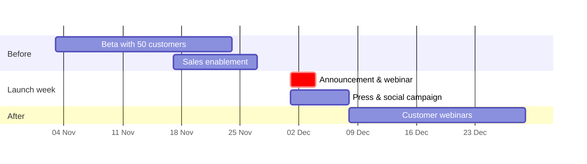

<!-- slide class="title" -->

# Atlas 2.0

Plan less. Ship more.

**{{author}}** · Product launch · {{month_year}}

<!-- slide class="quote" -->

> Every team should spend its time on the work — not on planning the work.
>
> — Our product vision

<!-- slide class="stat" -->

# 6 hours

a week the average team lead spends updating plans by hand

Note: From 140 customer interviews this year.

<!-- slide class="two-col" -->

## What's new

### Auto-planning

Atlas proposes a plan from your backlog and your team's capacity.

### Live roadmaps

Share a roadmap that updates itself as work moves.

### Workload view

See who is overloaded before it becomes a problem.

### Integrations

Two-way sync with the tools your team already uses.

<!-- slide -->

## Roadmap

1. **{{quarter}}** Atlas 2.0 general availability
2. **Next quarter** Mobile workload view
3. **+ 6 months** Portfolio planning
4. **+ 9 months** AI-assisted estimates

<!-- slide -->

## Pricing

| | Team | Business | Enterprise |
|:--|--:|--:|--:|
| Price per user / month | €9 | €19 | custom |
| Auto-planning | ✓ | ✓ | ✓ |
| Live roadmaps | — | ✓ | ✓ |
| Single sign-on | — | ✓ | ✓ |
| Dedicated success manager | — | — | ✓ |

<!-- slide -->

## Launch plan

<!-- slide -->

## How we'll measure success

- **2,000** trial sign-ups in 30 days
- **25 %** trial-to-paid conversion
- **40 %** of customers using auto-planning
- **NPS ≥ 45** after 60 days

<!-- slide class="end" -->

# Let's launch 🚀

Questions? · {{author}}
