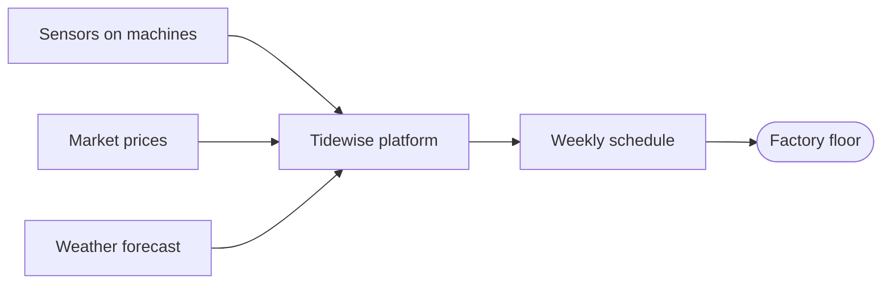

<!-- slide class="title" -->

# Tidewise

Energy software that lets small factories cut their power bill by a fifth

**{{author}}**, co-founder · Seed round · {{month_year}}

Note: Open with the one-line pitch. Pause after "a fifth".

<!-- slide class="stat" -->

# €19 bn

is what Europe's 2 million small manufacturers overpay for electricity every year

Note: Source: our analysis of Eurostat energy prices and load profiles of 300 factories.

<!-- slide -->

## The problem

- Energy is now the **second-largest cost** for small manufacturers
- Prices change every 15 minutes, but machines run on fixed schedules
- Big factories have energy managers; small ones have **nobody**
- Existing tools are built for utilities, not for a 40-person workshop

<!-- slide -->

## Our solution

<div class="cols">
<div>

### Plug in

A sensor kit installs in an hour, no electrician needed.

</div>
<div>

### Plan

Tidewise moves flexible jobs to the cheapest quarter-hours.

</div>
<div>

### Save

Owners see the savings every week, in euros.

</div>
</div>

<!-- slide -->

## How it works



<!-- slide -->

## Market

<div class="kpis">

- **€4.1 bn** total addressable market in the EU
- **€1.2 bn** serviceable: metal, plastics, food processing
- **€60 M** obtainable in 5 years in Benelux & DACH

</div>

Note: Bottom-up: number of plants × average contract value (€6,400 a year).

<!-- slide -->

## Traction

```chart
{
  type: "line",
  data: {
    labels: ["Jan", "Feb", "Mar", "Apr", "May", "Jun", "Jul", "Aug", "Sep"],
    datasets: [{ label: "Monthly recurring revenue (k€)", data: [4, 7, 11, 16, 22, 31, 39, 52, 68], borderColor: "#a78bfa", backgroundColor: "rgba(167,139,250,.25)", fill: true, tension: 0.35 }]
  },
  options: { plugins: { legend: { labels: { color: "#e4e1f5" } } }, scales: { x: { ticks: { color: "#a59fca" } }, y: { ticks: { color: "#a59fca" } } } }
}
```

<!-- slide -->

## Business model

| Plan | Price | Includes |
|:-----|------:|:---------|
| Starter | €290 / month | 10 machines, weekly schedule |
| Pro | €690 / month | 40 machines, live optimisation |
| Enterprise | custom | multiple sites, API |

Average customer saves **€2,100 a month** — a 3× return.

<!-- slide -->

## Competition

| | Tidewise | Utility portals | Industrial EMS |
|:--|:--:|:--:|:--:|
| Built for small factories | ✓ | ✗ | ✗ |
| Installs in an hour | ✓ | ✓ | ✗ |
| Optimises schedules | ✓ | ✗ | ✓ |
| Price per month | € | free | €€€€ |

<!-- slide -->

## Team

<div class="cols">
<div>

### {{author}}
CEO · ex-energy trader, 8 years

</div>
<div>

### Sam Okafor
CTO · built grid software at a utility

</div>
<div>

### Lea Hartmann
Sales · sold machinery to 300 SMEs

</div>
</div>

<!-- slide class="stat" -->

# €2.5 M

seed round to reach 400 factories and €3 M ARR in 18 months

Note: Use of funds: 55 % product and engineering, 30 % sales, 15 % operations.

<!-- slide class="end" -->

# Thank you

{{author}} · founders@tidewise.example
