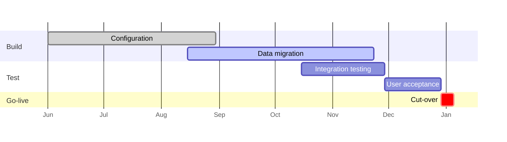

<!-- slide class="title" -->

# ERP Migration

Steering committee · status update

**{{author}}** · {{date_long}}

<!-- slide class="agenda" -->

## Agenda

1. Overall status
2. Milestones
3. Budget
4. Risks and issues
5. Decisions needed

<!-- slide -->

## Overall status

| Area | Status | Comment |
|:-----|:------:|:--------|
| Scope | <span class="badge green">On track</span> | No change requests this month |
| Schedule | <span class="badge amber">At risk</span> | Data migration 2 weeks behind |
| Budget | <span class="badge green">On track</span> | 46 % spent, 50 % of time elapsed |
| Quality | <span class="badge green">On track</span> | 312 of 340 test cases passed |
| People | <span class="badge amber">At risk</span> | One key user leaving in December |

Note: Lead with the two amber items; the rest is green.

<!-- slide -->

## Milestones



<!-- slide -->

## Progress

<div class="kpis">

- **78 %** of configuration complete
- **312 / 340** test cases passed
- **61 %** of master data migrated
- **4** open defects (0 critical)

</div>

<!-- slide -->

## Budget

```chart
{
  type: "bar",
  data: {
    labels: ["Licences", "Consultants", "Internal staff", "Training", "Contingency"],
    datasets: [
      { label: "Budget (k€)", data: [420, 680, 310, 90, 150], backgroundColor: "#c7d2fe" },
      { label: "Spent (k€)", data: [420, 298, 121, 12, 0], backgroundColor: "#1e3a8a" }
    ]
  },
  options: { indexAxis: "y" }
}
```

<!-- slide -->

## Risks and issues

| # | Risk / issue | Impact | Action | Owner |
|--:|:-------------|:------:|:-------|:------|
| 1 | Data migration delay | <span class="badge red">High</span> | Two extra data engineers for 6 weeks | IT |
| 2 | Key user leaving | <span class="badge amber">Medium</span> | Handover plan, backup user trained | Finance |
| 3 | Supplier API changes | <span class="badge green">Low</span> | Contract clause, test environment | Procurement |

<!-- slide -->

## Decisions needed

- **Approve** €48k from contingency for two extra data engineers
- **Confirm** the go-live window in the second week of February
- **Nominate** a backup key user in Finance by the end of the month

Note: Ask for each decision explicitly and write it down in the minutes.

<!-- slide -->

## Next steps

- [x] Finish configuration of purchasing
- [ ] Complete the second data load (customers, suppliers)
- [ ] Start integration testing
- [ ] Training plan for 140 users

<!-- slide class="end" -->

# Questions?

{{author}} · Project Management Office
