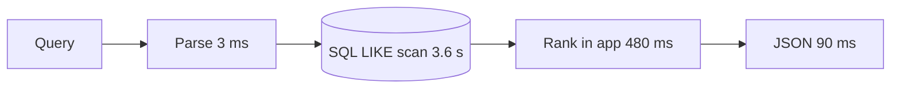
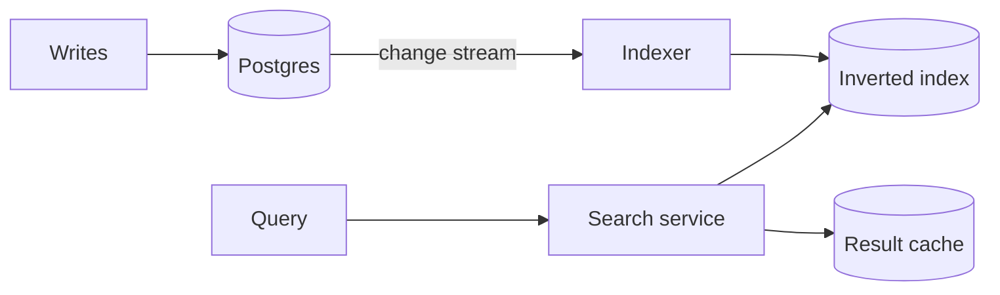

<!-- slide class="title" -->

# From 4 s to 40 ms

How we made search 100× faster without new hardware

**{{author}}** · Platform team · {{month_year}}

<!-- slide -->

## About me

- Platform engineer, 9 years in search and databases
- Broke production twice, fixed it three times
- Writes Rust at work and bad poetry at home

<!-- slide class="stat" -->

# 4.2 s

median search time a year ago — and users noticed

Note: Support tickets about slowness: 120 a month.

<!-- slide -->

## Where the time went



The database scanned **38 million rows** for every search.

<!-- slide -->

## The new architecture



<!-- slide -->

## Ranking in a few lines

```rust
fn score(doc: &Doc, terms: &[Term]) -> f32 {
    terms.iter()
        .map(|t| bm25(t.tf(doc), t.df, doc.len))
        .sum::<f32>()
        * freshness(doc.updated_at)
}
```

Note: BM25 plus a freshness boost got us 90 % of the way.

<!-- slide -->

## Results

```chart
{
  type: "bar",
  data: {
    labels: ["p50", "p90", "p99"],
    datasets: [
      { label: "Before (ms)", data: [4200, 7900, 12500], backgroundColor: "#475569" },
      { label: "After (ms)", data: [38, 71, 140], backgroundColor: "#38bdf8" }
    ]
  },
  options: { scales: { y: { type: "logarithmic", ticks: { color: "#7c8aa0" } }, x: { ticks: { color: "#7c8aa0" } } }, plugins: { legend: { labels: { color: "#cbd5e1" } } } }
}
```

<!-- slide -->

## What we learned

1. **Measure first** — our first guess (the network) was wrong
2. **Move work to write time** — index once, search many times
3. **Cache the boring queries** — 40 % of searches repeat within an hour
4. **Keep the old path** behind a flag until the new one proved itself

<!-- slide class="section" -->

# Demo

<!-- slide class="end" -->

# Questions?

{{author}} · slides and code: git.example.com/search-talk
